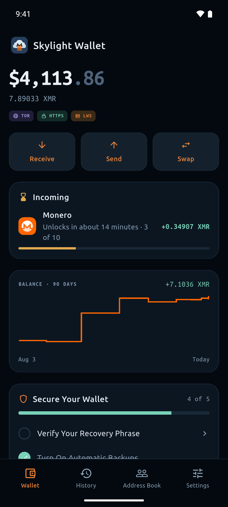
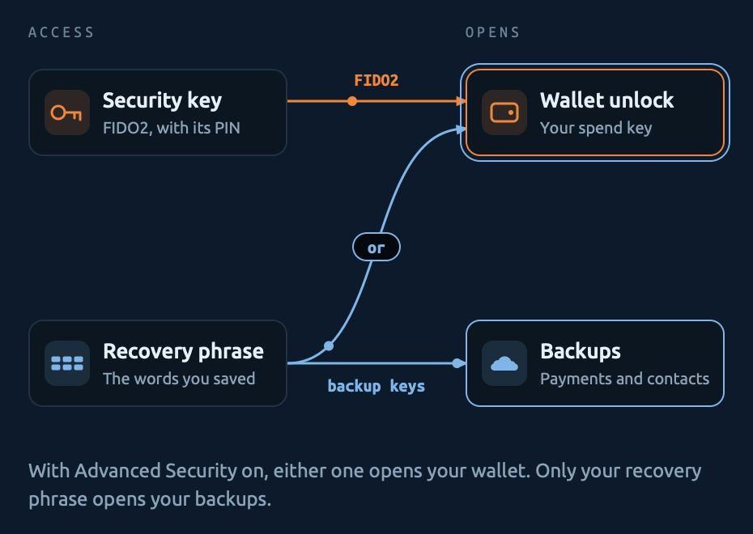
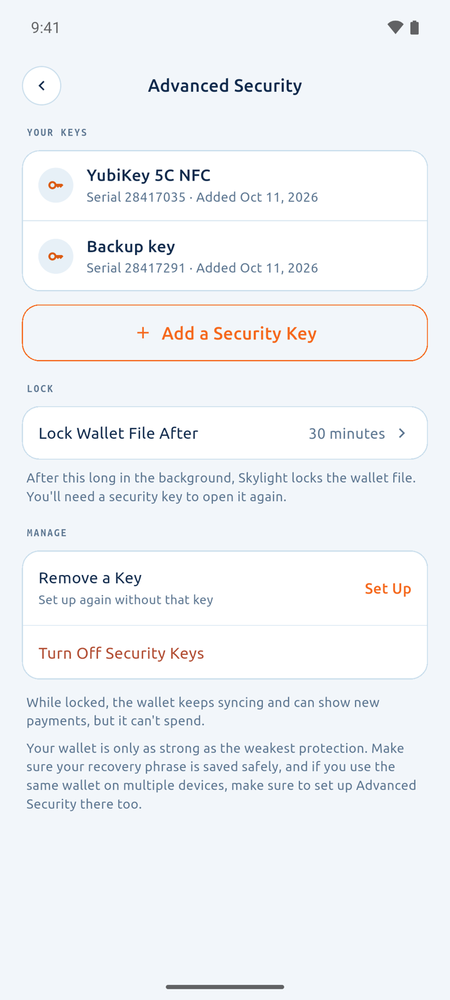
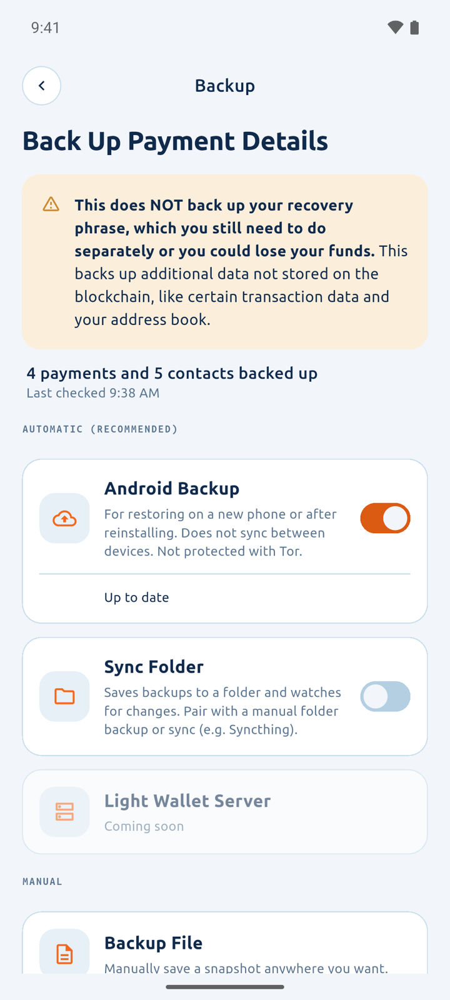
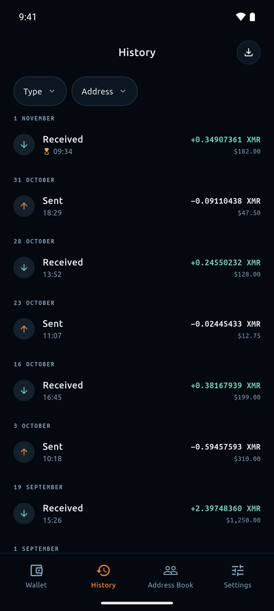
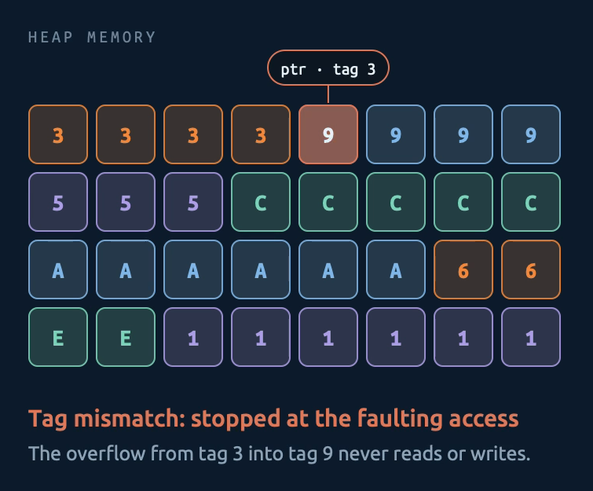
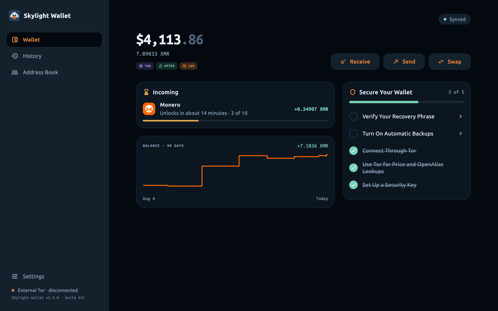

<video controls preload="metadata" playsinline poster="/img/posts/2026-11-02-skylight-wallet-2.2.0-video-poster.png" aria-label="Skylight Wallet 2.2.0 demo video showing the refreshed home screen, hardware security keys, encrypted backups, transaction filtering, hardened memory, and the desktop app">
  <source src="/img/posts/2026-11-02-skylight-wallet-2.2.0.mp4" type="video/mp4">
  <a href="/img/posts/2026-11-02-skylight-wallet-2.2.0.mp4">Watch the Skylight Wallet 2.2.0 demo video</a>
</video>

Skylight Wallet for Monero 2.2.0 includes many industry-leading security features, including features that have never been seen before in a Monero wallet.

## A Refreshed Home

The Skylight Wallet home screen has been redesigned to better show incoming transactions and their confirmations, your balance over time, and a checklist of steps to secure your wallet.

{: .screenshots}

## Your Recovery Phrase Now Does More

You already need to save your recovery phrase to protect your funds. So what if we securely use this recovery phrase as another password?

If your wallet uses a Polyseed or BIP39 recovery phrase, your recovery phrase is now securely used to unlock your encrypted local wallet files and to unlock encrypted backups. You don't need to remember three different passwords. Even if you lose your hardware security keys (more on those below), your recovery phrase still unlocks your wallet.

## Hardware Security Keys

We're very excited about this feature. Your wallet, its recovery phrase, and its spend keys can now be securely locked with FIDO2 hardware security keys, including YubiKeys. This is not a simple user interface lock. Instead, your wallet file itself is fully locked with Lee Clagett's FIDO2 hmac-secret encryption ([FHSE](https://github.com/vtnerd/fhse)). We require all hardware security keys to have a user-configured PIN, which can be a complex passphrase if you wish.

{: .screenshots}

If an attacker wishes to access your wallet, they either need your recovery phrase (which they could use to steal your funds anyway), or they need to pass your App Lock (Android, iOS, and macOS) or password (Linux and Windows), *plus* have your hardware security key, *plus* know the PIN that you set on your hardware security key (or match your fingerprint, on a YubiKey Bio).

You can choose how long Skylight Wallet waits before it fully locks the wallet file.

If you want to improve your security posture and don't already have hardware security keys, we recommend that you purchase them from a reputable retailer. They can elevate your security more than a password manager alone. We recommend that you configure at least two hardware security keys in case you lose one, but you can configure Skylight Wallet with more.

On iPhone and iPad, YubiKeys work over NFC (firmware 5.2 or later) or USB-C (firmware 5.8 or later). On Windows, hardware security keys require Windows 11 version 22H2 or later, and on Linux, they require libfido2.

This new security key feature allows many practical security improvements. Instead of needing to rely on Skylight Wallet to properly prevent brute-force login attempts to your wallet, you can rely on the brute-force protections on the hardware security key itself (after too many incorrect PINs, the key locks and must be reset, which erases its credentials). If you don't need to access your wallet while traveling, you can leave your hardware security keys in a safe at home.

As we implemented this feature, we better isolated the view-only and spend parts of your wallet. Background syncing, if enabled, still works by using only your view key for both node mode and light-wallet mode. You will still receive incoming transaction notifications even with your spend key fully protected.

We know that some users really hate saving their recovery phrase, and we explored whether we could implement FHSE into Skylight Wallet, back up the wallet files, and then emphasize restoring with the hardware security keys and wallet file *instead* of the recovery phrase. However, this is unfortunately not as safe as we want it to be. Since we don't run a login server for Skylight Wallet (and we don't want to), you could be tricked into approving a Skylight Wallet challenge on your security key for a malicious app, and this malicious app could then reuse the challenge to access the wallet files. Normally, FIDO2 protects against this by checking that the website you're signing in to matches the domain that the credential was created for.

Due to this limitation, we have designed Skylight Wallet to protect these wallet files from access by any other application to the extent that is reasonable for the operating system that the application is running on. For Android, iOS, and macOS, your wallet files are excluded from device backups, and the password that encrypts them is kept in the device's secure storage. For Windows, if your PC has a TPM, we bind your wallet files to it so that if they are copied (e.g., accidentally backed up to a NAS), they can't be opened on another computer without a quantum computer. For Windows and Linux, there are currently no meaningful protections against a malicious app running under your user account trying to capture your hardware security key challenges and reuse them on the files, so you will unfortunately need to be hyper-vigilant on these platforms.

This is also not a full replacement for an offline, cold storage wallet. If there is some catastrophic issue with the host operating system, then this security feature may not protect you.

Interestingly, FHSE does not rely on the ECDSA signatures affected by the [2024 YubiKey vulnerability](https://www.yubico.com/support/security-advisories/ysa-2024-03/), so it is not susceptible to it. Skylight Wallet could be a uniquely good use of these older hardware security keys.

## Encrypted Backups

Unlike most other cryptocurrencies, important information about your Monero transactions is *not* stored on the blockchain and thus is *not* recoverable with the recovery phrase alone. This includes the addresses that you send funds to and the transaction keys that help prove payment to those addresses.

We set out to make backing up this information as painless, private, and secure as possible.

{: .screenshots}

If you use Skylight Wallet with a Polyseed or a BIP39 recovery phrase (not a legacy Monero 25-word recovery phrase), then you can enable automatic or manual backups of your wallet metadata. Backups are off until you turn them on.

On iPhone and iPad, you can enable iCloud, which will automatically back up the addresses you paid, your transaction keys, and your contacts, and it will automatically sync this information across your iPhones and iPads.

On Android, you can enable Android Backup. For most users, this will back up your data to Google Drive about once a day. On GrapheneOS, CalyxOS, and some other systems, it will use the phone's own backup service, such as Seedvault. Android Backup restores your data on a new phone or after reinstalling Skylight Wallet, but it does not sync between devices.

On any platform, you can continuously save files into a sync folder, which you can then keep in sync across your devices using Syncthing or another folder-sync app. On desktop, the sync folder can also be on a NAS. You can also save a single-file, one-time snapshot backup to a location of your choice.

The backup files are secured with symmetric encryption derived from your recovery phrase. We purposefully chose to solely use symmetric encryption to avoid the quantum risk to asymmetric encryption algorithms. Cloud services cannot read what's inside.

Automatic backups might not be right for you if you are worried about the cloud provider seeing when you add data to your backups and how much data you add. Skylight Wallet takes care to mitigate this leaked information somewhat with padded file sizes and randomly (slightly) delayed payment uploads, but you may still consider this metadata too sensitive to enable this setting.

In the future, Skylight Wallet will support automatic backups to your LWS.

## Transaction Filtering

Your transaction history now lives in a dedicated screen. You can filter transactions by direction, or you can filter by the address that received funds. This makes it simpler for you to identify transactions that you used to pay specific people, or to identify all transactions you received at the same address.

{: .screenshots}

You can now also export your transaction history (all of it, or just the transactions that match your filters) as a CSV file.

## Hardened Memory

In release builds, we have enabled the strictest native memory protections available on Android, iOS, and macOS. These protect the native code inside Skylight Wallet, such as Monero, Tor, and FHSE.

For Android, Skylight Wallet uses Arm Memory Tagging Extension (MTE) in synchronous mode on supported devices (Pixel 8 and later, when MTE is turned on), GWP-ASan on every launch, and zero-initialized heap allocations.

For iOS and macOS, Skylight Wallet uses Apple's Enhanced Security hardened process with a hardened heap, plus Memory Integrity Enforcement (hardware memory tagging on iPhones with an A19 chip and Macs with an M5 chip) in enforced mode. These require iOS 26 or macOS 26 and later.

Practically, these protections help prevent sophisticated security and privacy attacks that could arise from the Tor network, from nodes and servers you connect to, and from OpenAlias lookups. A use-after-free or buffer overflow is stopped at the faulting memory access instead of being exploited.

This could impact performance, and since these protections stop the app at the first invalid memory access, a latent memory bug could make the app close on supported devices. Please let us know if you run into performance issues or crashes. In our testing, we did not observe any worsened performance.

## Desktop is Finally Good

We teased our desktop apps in the 2.0.0 release, but they are much better now. The redesigned desktop app looks better, and it includes every new feature in this release. Give it a try!

## Thank You

Thank you for using Skylight Wallet. Please make your voice heard [in our Matrix community](https://matrix.to/#/#skylight-wallet:monero.social).

[Download Skylight Wallet](https://skylight.magicgrants.org){: .btn-primary}
